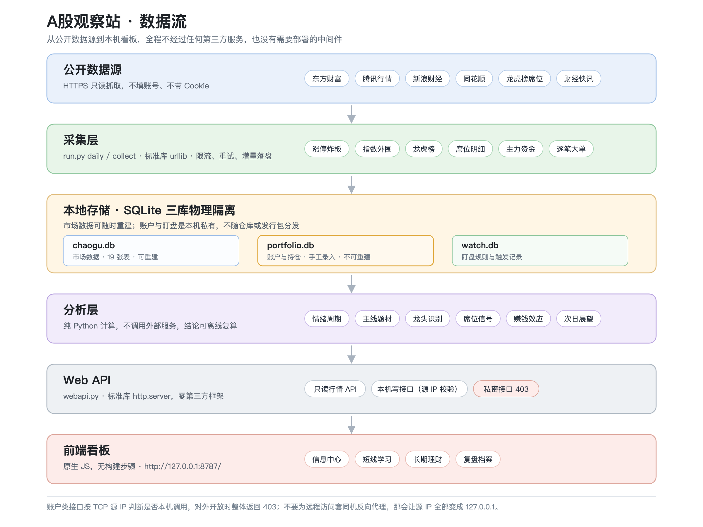
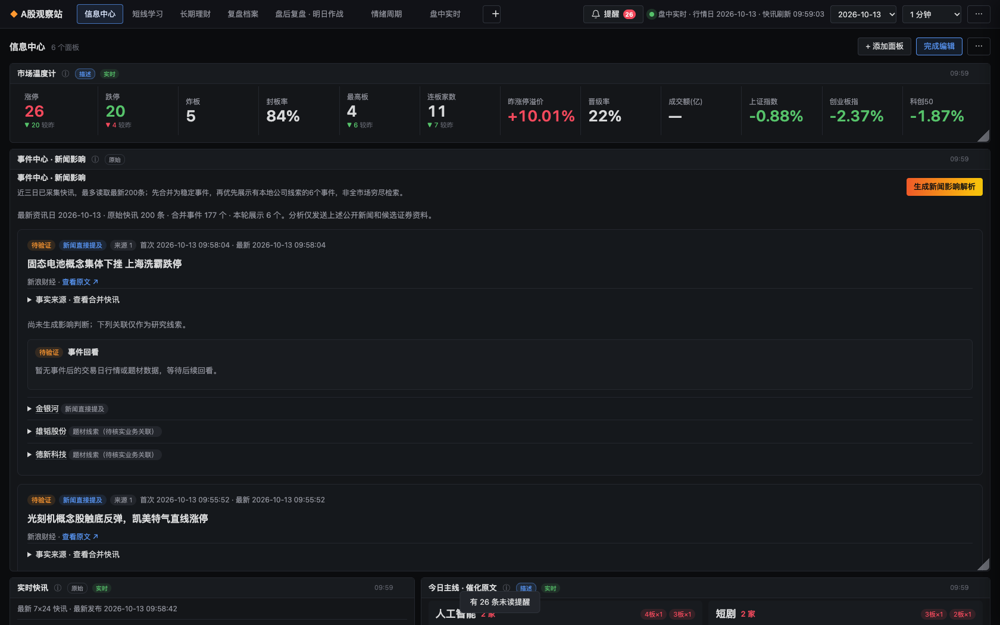
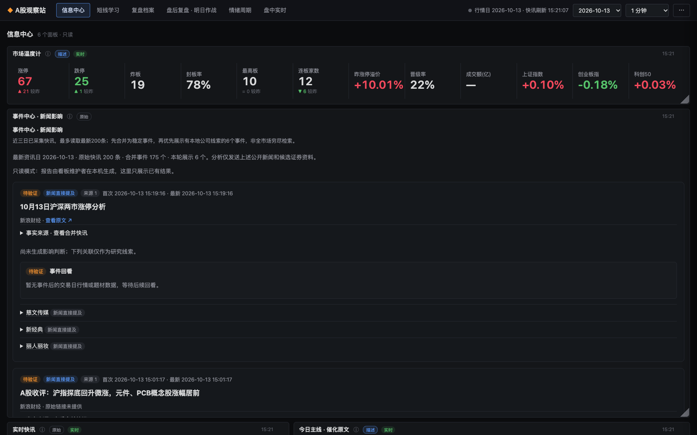
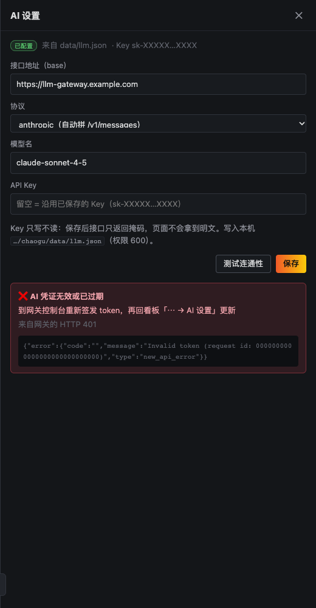

# A股观察站（a-share-observer）

一个在本机运行的 A 股信息、学习、理财和复盘工作台。聚合公开市场数据与新闻事件，
整理短线结构，管理长期资金边界，把每天判断留痕以便回验。

纯 Python 标准库 + 原生 JavaScript：**不装第三方包、不需要构建、不连任何云服务**。
持仓和复盘记录留在你自己的硬盘里。



## 先说不做什么

- **不交易**。没有下单、撤单、转账接口，也没有券商委托通道。
- **不预测**。项目里跑过的检验表明，靠情绪指标预测次日涨跌不成立，文档如实写了这个结论。
- **不推荐个股**，不承诺收益。

它做的事情是：把当天发生了什么、处在什么阶段、主线在哪，整理成你能反复看的结构。

## 核心特性

**结论先行** — 打开看板第一屏就是今日情绪阶段、明日前 3 主线及龙头、风险提示，不用翻表格。

**面板位置自己摆** — 24 列栅格，每块面板记住自己的 `(x, y)` 和宽高。拖标题栏移动、拉右下角改大小，松手按重力压实，自动保存。Grafana 那套习惯直接能用。

**面板可信度角标** — 每块面板标题旁标明它能支持什么判断：`已验证`（样本外检验过）、`回测`（有条件成立）、`描述`（只说明当前状态）、`原始`（未加工数据）、`规则`（你自己设的提醒）、`账户`（本机数据）、`AI`（需对照数据核对）。点 ⓘ 看口径和局限。

**三库物理隔离** — 市场数据、账户持仓、盯盘规则分别落在三个 SQLite 文件里。行情库删了能重建，账户库是手工录入的、丢了不可恢复，所以读写路径完全分开。

**长期驻留** — 数据新鲜度指示灯、崩溃自动拉起、收盘后自动采集。macOS 走 launchd，`tools/dash.sh` 一条命令装好开机自启。

**内网只读分享** — 给同事看行情时，账户、盯盘、AI 面板和所有写接口按来源 IP 挡住，前端自动收起写入口。

**可选 AI** — 不配也能用全部规则功能。配了可以一句话生成复盘、对新闻事件做影响判断。密钥只存在本机 `data/llm.json`，权限 600。

## 界面

信息中心。左侧是当日结构，右侧是事件与快讯，栅格布局可以自己重新排：



内网只读视图。同样的看板，但看不到账户，也没有任何写入口：



AI 设置。可选功能，不填也能跑：



## 5 分钟开始使用

要求 Python 3.10 或更新版本，没有其他依赖。

```bash
git clone https://github.com/dongdonglog/a-share-observer.git
cd a-share-observer
./setup.sh                          # 建虚拟环境、初始化数据库、离线自检
./.venv/bin/python run.py daily     # 首次采集（联网，约 10 分钟）
./.venv/bin/python run.py dash      # 启动看板
```

打开 <http://127.0.0.1:8787/>。

`setup.sh` 本身不联网，只做环境和自检。采集和注册常驻服务是两件有副作用的事，
所以做成显式开关：

```bash
./setup.sh --collect                 # 建环境 + 首次采集
./setup.sh --start                   # 建环境 + 后台启动
./setup.sh --collect --autostart     # 采集 + 装 macOS 开机自启
```

Windows 用 PowerShell：

```powershell
git clone https://github.com/dongdonglog/a-share-observer.git
Set-Location a-share-observer
.\setup.ps1 -Collect -Start
```

装完随时可以自检，这一步离线，不采集也不写数据库：

```bash
./.venv/bin/python run.py doctor
```

它会检查 Python 版本、程序文件完整性、目录可写、SQLite 完整性、AI 配置权限、看板端口。
**看板起不来时第一步就是跑它。**

## 日常使用

收盘后跑一次当日流程：

```bash
./.venv/bin/python run.py daily      # 采集 + 指标 + 报告
./.venv/bin/python run.py lhb        # 当日龙虎榜（盘后才有数据）
./.venv/bin/python run.py seat       # 席位排行与跟随信号
```

报告写到 `reports/YYYY-MM-DD.md`，看板是同一份数据的在线视图。

看板常驻（macOS）：

```bash
./tools/dash.sh start      # 后台启动
./tools/dash.sh status     # 状态 + 该发出去的内网地址
./tools/dash.sh logs 80    # 最近 80 行日志
./tools/dash.sh stop       # 停止
./tools/dash.sh install    # 装开机自启（崩溃自动拉起）
./tools/dash.sh uninstall  # 卸载自启
```

更多命令：

| 命令 | 作用 |
| --- | --- |
| `run.py status` | 数据状态、最新交易日 |
| `run.py report --print` | 生成并打印当日报告 |
| `run.py style` | 龙虎榜席位行为画像 |
| `run.py llm-setup` | 配置 AI（可选） |
| `run.py backfill --days 90` | 回填历史涨停/炸板/题材 |
| `run.py prices --scope limitup --days 160` | 回填历史价格 |
| `run.py recompute` | 重算全部指标 |

## 内网分享给别人看

默认只监听 `127.0.0.1`，只有本机能访问。要让同事看行情：

```bash
DASH_HOST=0.0.0.0 ./tools/dash.sh install
./tools/dash.sh status          # 会打印「内网：http://<你的内网IP>:8787/」
```

对方看到的是公开行情看板，界面标「只读」并收起全部写入口。
`portfolio_` / `watch_` / `ai_` 前缀的面板、`/api/portfolio`、`/api/watch`、`/api/ai/*`、
`/api/dashboards` 对非本机来源全部返回 403。AI 面板内容本身是市场数据，但每打开一次
就真实消耗你的模型额度，所以按私密处理。

**不要改成套一层 nginx 反向代理。** 账户接口按 TCP 源 IP 判断来源，反代会让源 IP
全部变成 `127.0.0.1` 同时改写 Host，四道校验同时失效，账户直接暴露。细节见
[运行维护](docs/OPERATIONS.md) 的「数据与隐私」。

## 打包发给别人

```bash
./tools/pack.sh            # → dist/a-share-observer-YYYYMMDD.zip
./tools/pack.sh --no-zip   # 只准备目录，调试用
```

**别用 `git archive`，也别手动右键压缩。** 项目根目录混着 `data/`（账户库、API Key）、
`reports/`（个人复盘）、`.workbuddy/`（含密钥片段的工作日志），手选文件漏一个就是把账户
发给别人。脚本排除本地状态与凭据、抹掉本机绝对路径，然后做三重自检：包内不得有
`*.db`/`__pycache__`、不得有真实 API Key、关键启动文件齐全且语法可编译。
**自检不过就不出包。**

对方拿到后解压 → `./setup.sh` → `run.py daily`（包里不含行情数据，这步不能省）→ `run.py dash`。
Windows 解压可能丢可执行位，报权限不足就先 `chmod +x setup.sh`。

项目另带一份 [`skills/a-share-observer/SKILL.md`](skills/a-share-observer/SKILL.md)，
是给 AI 助手用的部署与排障技能，拷进助手技能目录即可。

## 架构

六层数据流：公开数据源 → 采集层 → 本地 SQLite 三库 → 分析层 → Web API → 前端看板。
详细模块职责、扩展数据源和新增面板的约定见[系统架构](docs/ARCHITECTURE.md)。

```
chaogu/
├── sources/      各数据源适配（东财、腾讯、新浪、同花顺、龙虎榜）
├── collect.py    采集编排
├── metrics.py    情绪指标计算
├── theme.py      题材与主线
├── seat.py       席位分析（唯一验证有效的信号）
├── portfolio.py  账户与资金规划
├── watch.py      盯盘规则
├── webapi.py     HTTP API（标准库 http.server）
└── web/          前端（原生 JS，无构建）
```

## 文档导航

| 文档 | 内容 |
| --- | --- |
| [安装与首次启动](docs/INSTALL.md) | macOS / Linux / Windows 完整安装，首次数据准备 |
| [运行维护与排障](docs/OPERATIONS.md) | 日常命令、备份恢复、安全边界、常见问题、长期驻留 |
| [功能详解](docs/FEATURES.md) | 看板、栅格布局、账户、事件中心、盯盘、资金异动 |
| [研究笔记](docs/RESEARCH.md) | 指标口径、实证发现（含不成立的结论）、数据源踩坑、局限 |
| [系统架构](docs/ARCHITECTURE.md) | 数据流、模块职责、本地状态、扩展约定 |
| [东方财富只读接入](docs/EASTMONEY.md) | 协议来源、验证状态、停止条件 |
| [盯盘提醒与人气异动](docs/WATCH.md) | 规则条件、榜单基准、触发记录 |
| [席位跟随操作手册](docs/席位跟随操作手册.md) | 席位指标、检验口径、日常用法 |
| [交给 AI 助手部署](docs/AI_SETUP.md) | 可直接复制的部署请求与执行边界 |

## 数据与隐私

三个库物理隔离，读写路径分开：

| 文件 | 内容 | 可否重建 |
| --- | --- | --- |
| `data/chaogu.db` | 市场数据，19 张表 | 可以，重新采集即可 |
| `data/portfolio.db` | 账户与持仓 | **不可以**，手工录入 |
| `data/watch.db` | 盯盘规则与触发 | 规则可重建，历史触发记录不可 |
| `data/llm.json` | AI 配置，含明文 Key | 权限 600，不随仓库分发 |

`data/`、`reports/`、日志都在 `.gitignore` 里。迁移或升级前先备份 `data/`。

## 局限

- 样本期只覆盖 2026 年 1-9 月一轮行情，未经历完整牛熊。
- 开盘价缺失，跳空只能近似处理。
- 席位策略的重叠持仓让 Sharpe 显著性被系统性抬高。
- 情绪指标能描述当期状态，**不能预测次日**。
- 窗口宽度 ≤1100px 时栅格布局退化为单列。

完整的实证过程、失败结论和口径缺口见[研究笔记](docs/RESEARCH.md)。

## 免责声明

本项目用于个人研究和复盘，不构成投资建议，不承诺任何收益。据此操作风险自负。
市场数据来自公开接口，可能存在延迟、缺失或错误。

## License

Apache-2.0，见 [LICENSE](LICENSE)。第三方组件声明见 [THIRD_PARTY_NOTICES.md](THIRD_PARTY_NOTICES.md)。
