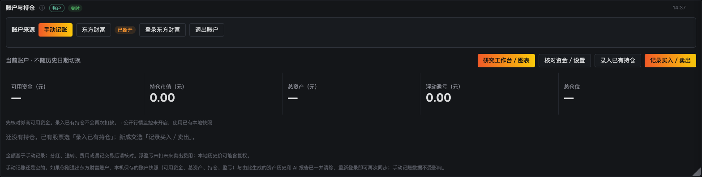

# 东方财富本机只读账户接入

## 验证状态与入口

实现日期：2026-10-02。入口是看板「账户与持仓」→「登录东方财富」。
真实账号由用户在本机表单内填写，不应发到聊天中。

已实际核验公开官方登录页面和脚本、正常 HTTPS 证书校验下的初始化，以及
JSEncrypt 加密结果与 OpenSSL 的互通。未提交真实或虚构凭证到券商。
用户已反馈真实登录成功。已修复查询前错误依赖脚本文本匹配的判断；资金/持仓查询及短信仍待验收。

## 官方协议来源与停止条件

- 登录来源：<https://jywg.18.cn/Login>，同域 `/JsBundles/LoginSec`、`/JsBundles/BaseJS`。
- 2026-10-20 官方更新 `LoginSec`：普通网页登录地址由 `/Login/Authentication` 改为
  `/Login/AuthenticationSec`，字段与控件条件不变；新增 `ErrCode=-13`「验证开户手机号」
  （`/Com/sendSMSVerCode4LoginWEB` + `loginLimitCert`），本接入未实现，遇到时停止并提示去官方完成。
- 登录字段：`userId/password/randNumber/identifyCode/duration/authCode/type/secInfo`；
  正常网页 `type=Z`，使用官方「3 小时」选项原始值 `duration=1800`，不自行解释单位。
- `LoginSec` 当前控件条件为 `SecHelper.isWin() && __secStage == "2"`；
  `isWin()` 检查 UA 中的 Windows。Mac 普通网页不是 Mac 原生客户端的专有登录流程。
  未实现安全控件桥接；Windows 要求控件或上游返回控件要求时直接停止。
- 固定已审查 `LoginSec` 的 SHA-256；变更后暂停，不能仅为通过检查更新哈希。
  公钥每次通过正常 HTTPS 从官方 BaseJS 的 EMTradeEncrypt 实现提取。
- `ErrCode=-11` 要求手机验证。短信发送和验证路径分别为
  `/Login/GetMsgVerifyCode_12`、`/Login/GetCheckMsgVerCode_12`；用户填写末四位号码、
  图形验证码与短信验证码。成功后要求用户重新输入密码，不自动重试登录。
- 查询校验值来自登录后的 `/Search/Position`。直接调用固定白名单中的
  `/Com/queryAssetAndPositionV1` 只读端点，POST `moneyType=RMB`。不再要求其地址字面量出现在
  查询页面的脚本文本中；页面资源布局不是 API 能力证明，实际响应须通过下述严格校验。
  资产和持仓在一次响应内读取，预期 `Data` 为单元素数组，该元素含 `positions` 数组。
  字段映射：资产 `Kyzj/Zzc/Zxsz`，持仓 `Zqdm/Zqmc/Zqsl/Kysl/Cbjg/Zxjg/Zxsz/Ljyk`。
  总浮盈亏为各持仓的券商 `Ljyk` 之和。未读取到字段时禁止默认填零。
  查询契约的候选来源还参考了公开项目
  [emtl](https://github.com/riiy/emtl/blob/master/src/emtl/const.py) 和
  [EastPyTrade](https://github.com/GongZhengke/EastPyTrade/blob/main/eastmoney_trade_api.py)，
  未执行其代码。它们不是官方文档；真实响应仍需核实。数据不完整时保留旧快照和连接，
  会话失效或认证流程不兼容时退出。
- `/Login/ExitLogin?clear=1` 为官方退出入口。任何请求都不跟随重定向；
  退出重定向到官方 Login 页才视为正常退出。网络失败仍清理本机会话，并提示官方退出未确认。

## 数据与会话

Python 仅使用标准库。独立 urllib opener 使用系统信任的 SSLContext，禁用环境代理，
限定官方主机与认证、只读查询、退出及页面静态脚本路径。没有通用 URL 代理或交易方法。
原项目公开行情网络模块不用于券商连接。

CookieJar、短信验证所需账号、校验令牌和登录窗口标识只存在进程内存。
后端只接收加密密码；前端提交即清空密码，关闭弹窗清空表单 DOM。
不使用浏览器持久存储或 Cookie 保存账号/密码。JavaScript/Python 无法保证垃圾回收前的物理
内存立即擦除；“清除”是释放引用并禁止后续复用，不声称安全内存擦除。

会话锁串行化登录/刷新/退出，避免退出后旧请求重新写入快照。
使用墙上时钟和单调时钟共同检查闲置；休眠跨过 24 小时或系统时间回退时退出。
页面仅对可见页面中 `isTrusted` 的实际交互发送活动请求（最多每 30 秒一次）。
状态查询、页面刷新、后台同步不触碰活动时间；到期后的交互不能复活会话。
每次登录先立即读取完整快照，只有用户核对该次快照版本后才每 60 秒同步。

`portfolio.db` 添加独立来源偏好、券商快照和券商观察条件表。
首次迁移前 `sqlite3.Connection.backup()` 备份（包括 WAL 中已提交的内容）。
所有规范化字段完成验证后，在单个 SQLite 事务内替换快照。
字段缺失、非有限数值、可卖数超限、分页/市值不匹配不会替换旧快照。
代码接受六位数字、首尾空白、SH/SZ/BJ 前缀或点/冒号/短横线分隔的交易所后缀；JSON 整数代码补足六位。
无法识别代码时只提示行号，不回显原始值。名称缺失、财务字段缺失等会提示已验证的证券代码。
六位代码的非 A 股证券保留全部财务字段；场内基金号段及明确的基金名称归为基金，其余单列其他证券。
基金按名称关键词匹配本地 `sector_daily`，注明为投向线索，不当作已核验跟踪指数/成分权重。
跨境基金不直接使用境内板块涨跌幅作为其市场表现，不套用股票 T+1。
同代码记录先逐行计入券商市值核对；核对通过且名称、现价及显式交易所标识一致才合并。
数量、可卖数、市值、盈亏累加，成本按数量加权。不会通过删除疑似重复行来凑平市值。
上述数据错误不会误判为认证失败，也不会强制退出登录；用户可立即同步重试。
市值核对失败时，仅在会话内存保留已验证的汇总市值、明细市值、差额、条数及证券代码/数量/现价/市值。
本机状态接口返回这份诊断帮助定位口径问题，页面展示核对金额；不保存原始响应、账号或会话令牌，
不写数据库、日志或 AI 请求，成功同步或退出即清除。首次同步失败明确显示「尚未保存账户快照」。
用户明确确认正差额全部为现金理财后，以 `extra_assets` 记录金额和 `user_confirmed_difference` 来源。
确认记录仅保存于权限 0600 的 `data/eastmoney-asset-confirmation.json`，不含凭证；绑定差额及完整的代码/数量列表。
正常价格变化可继续同步，差额或数量变化不自动分类。页面核对使用当前诊断版本，并重新查询验证后才原子保存。
字段缺失、明确分页、负差额、重复冲突等仍拒绝；不以扩大容差替代资产核对。
资产图各类金额合计等于券商总资产；总资产减证券市值的余额列为「现金及其他净资产」，不伪称可用现金。
可用资金可能含可用天天宝额度，不能二次加总。投资仓位与总仓位预算只计证券明细，单列现金理财不占该额度。
本次无需修改数据库结构；新增财务字段仍保存在独立券商快照 JSON 中。
同步时间表示读取券商快照的时间，不表示市场报价的成交时间。

AI 请求以显式字段白名单构建。登录框默认开启一次自动分析，也可关闭。每次登录仅在首次完整
同步后领取一次后台任务，失败不自动重试；只重试查询成功后才可领取未触发过的任务。
被动查看分析和 60 秒同步不调用模型；资金、价格、条件或盘面变化后旧分析失效，单纯更新同步
时间不使分析过期。模型调用独立于券商会话锁；退出/换账号/切回手动来源后不发布旧任务结果。
退出、网络错误和旧数据状态也会传入研究上下文，防止把过期余额当成当前可用资金。

### 会话结束即清除本机账户数据

**退出登录等于把账户数据从这台机器上删掉，不是只断开连接。**

早先的行为是退出后仍在 `portfolio.db` 保留最后一份快照，界面上显示「已断开 + 最后成功同步时间」。
这个中间态经用户反馈确认不妥：金额和持仓还挂在页面上看不出是旧数据，磁盘上也一直留着一份
完整账户数据，「退出」名不副实。

会话结束有 5 条路径，全部走同一个出口 `Session._logout()`，因此清除也统一在这里做：

| 触发 | 说明 |
| --- | --- |
| 用户点「退出账户」 | 先弹确认框列出会删什么，返回的 `purged` 回显实际删除行数 |
| 连续 24 小时无操作或系统时间回退 | 超时同样是会话结束 |
| 认证过期 / 被券商踢下线（`Expired`、`Unsupported`） | 会话已不可用 |
| 进程收到 SIGTERM / 正常停止 | `dashboard.serve()` 的 `finally` 会调一次退出 |
| 重新打开登录框时放弃旧会话 | `initialize()` 结束上一段会话 |

进程被 `SIGKILL`、崩溃或断电时 `finally` 不执行，所以看板启动时还会调一次
`eastmoney.purge_orphaned()` 兜底：此刻一定不存在活会话，留着它唯一的后果就是下一个人打开
看板还能看到上一个人的钱。

清除范围是**账户派生数据**，共 6 张表——只删 `broker_snapshot` 是不够的：

| 表 | 内容 |
| --- | --- |
| `broker_snapshot` | 可用资金、总资产、市值、盈亏与逐笔持仓 |
| `wb_history` | 每次同步的资产时间序列与每只股数 |
| `wb_reports` | AI 账户报告正文（含持仓名与仓位占比） |
| `analysis` | AI「持仓研究清单」markdown |
| `wb_research` | 按持仓代码缓存的历史行情，等于一份持仓标的清单 |
| `broker_observations` | 该账户的止损/止盈/加仓观察价与理由 |

同时把 `portfolio_source.source` 复位为 `manual`：留着 `eastmoney` 会让面板继续渲染一个空券商
视图，用户会以为数据还在、只是没加载出来。

明确**不动**的：`account` / `positions` / `transactions`（用户自己记的手动账）、`wb_profile`
（资金规划偏好，属于用户设置而非账户信息）、`benchmark:%` 行情缓存（沪深 300 之类公开基准）。
纯手动记账的库里没有券商数据，`has_broker_data()` 为假，启动清除会跳过，不会白删 `analysis`。

清除失败不会被静默吞掉：`purge_broker_data()` 抛错时会把「本机账户数据清除失败，请手动清理
`data/portfolio.db` 中的券商数据」写进状态里的 `query_error`。

退出后的账户面板：金额与持仓全部归零，来源回到手动记账，并说明本机数据已清除。



## HTTP 接口

所有路径前缀为 `/api/eastmoney/`：

| 方法 | 路径 | 行为 |
| --- | --- | --- |
| GET | status | 状态、错误文案、同步是否开启、白名单财务诊断，不返回凭证 |
| POST | init | 检查官方流程，创建内存登录窗口，返回公钥 |
| POST | captcha | 返回当前流程的官方图形验证码图像 |
| POST | login | 单次认证并立即同步，错误不自动重试 |
| POST | sms-send / sms-verify | 用户完成手机验证 |
| POST | refresh | 手动同步 |
| POST | confirm | 用户核对当前快照版本后开启定时同步 |
| POST | reconcile | 用户确认当前正差额全为现金理财；重新查询匹配后保存并触发待执行分析 |
| POST | activity | 真实操作续期，先检查是否已超时 |
| POST | logout | 官方退出，并**清除本机保存的全部账户数据**（见上节）；响应带 `purged` 回显各表删除行数 |

`POST /api/portfolio/broker` 切换来源、修改券商观察条件和仓位上限。
`GET /api/portfolio` 返回来源、连接状态、最后成功同步时间和查询错误。
敏感账户接口要求 loopback 客户端及匹配本机端口的 Host；POST 还要求同源 Origin 和 JSON。
拒绝跨站请求、DNS rebinding、超大请求体。所有响应 no-store，禁止 iframe 嵌入。

## 离线验证与本人验收

```sh
python3 tools/test_portfolio.py
python3 tools/test_eastmoney.py
node tools/test_eastmoney_crypto.js  # 开发校验需 Node 和 OpenSSL；应用运行不依赖它们
node --check chaogu/web/app.js
```

模拟测试覆盖成功/验证码错误/短信/控件不支持/会话提前过期/退出与重启、轮询不续期、
24 小时与休眠跨期、完整零持仓与异常空持仓区分、旧快照保护、手动账本隔离、备份及凭证排除。
另覆盖会话结束时 6 张账户派生表被清空、公开基准与手动账本不受影响、启动期孤儿清除对纯手动
库跳过。
另覆盖证券代码规范化、混合证券的资产及研究隔离、多条持仓汇总、重复响应不猜测去重、
校验幂等性、其他资产变化导致 AI 分析过期，以及错误不泄露原始证券字段且保留登录连接。
浏览器验收使用临时数据库和模拟券商，验证表单、来源切换、观察条件、启用同步和退出显示。

最后由用户本人登录，与东方财富界面逐项核对资金、资产、持仓、可卖数量；若页面提示协议
不兼容或字段缺失，保持自动同步关闭，不导出含账号/Cookie/令牌的原始响应到聊天或日志。
匹配成功后由用户点击核对按钮。模拟响应测试不替代这一步。

## 前端加密代码来源

`chaogu/web/vendor/jsencrypt-eastmoney.js` 从官方 BaseJS 提取 JSEncrypt 3.0.0-rc.1，
只增加来源注释，未改动算法。MIT 许可证见同目录 `jsencrypt-LICENSE.txt`。
文件 SHA-256：`34442115b33f3213ed5095a8108fbb67abfe6d643e69b5a52a59d7d4531c0d74`。
